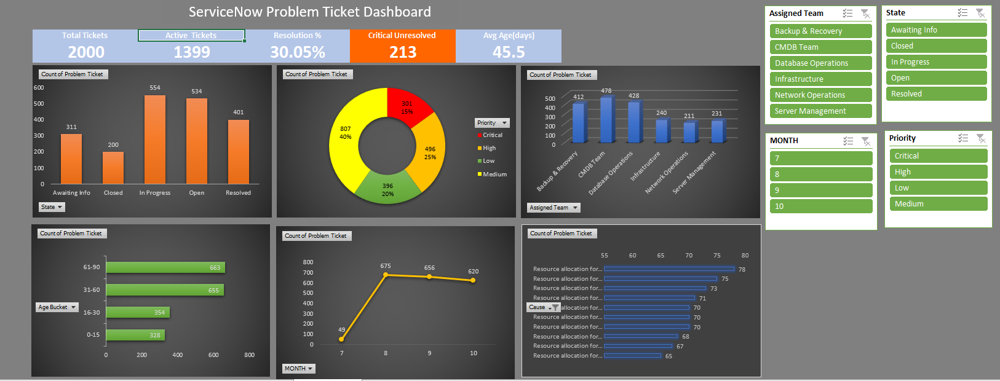

# ServiceNow Problem Ticket Analysis Dashboard (Excel)

## Business Problem
ServiceNow problem tickets are exported as a flat file of 2,000 rows, which makes it hard to see backlog size, urgency, ageing and team workload. This project turns the export into an Excel dashboard.

## Dataset
- 2,000 problem tickets, 9 columns, 6 resolver teams
- Created between 30 Jul 2025 and 27 Oct 2025

## Tools Used
Microsoft Excel, Power Query, PivotTables, PivotCharts, Slicers, COUNTIFS, AVERAGEIFS

## Key Findings
- 1,399 of 2,000 tickets (69.95%) are still active; 30.05% are Resolved or Closed
- 213 of 301 Critical tickets (70.8%) are unresolved
- 553 Critical and High tickets are active
- 929 active tickets (66.4%) are older than 30 days; 457 are older than 60 days
- CMDB Team, Database Operations and Backup & Recovery hold 1,318 tickets (65.9%)
- Database Operations has the most Critical active tickets (55)
- 311 tickets are in Awaiting Info status

## Dashboard

## How the Project Was Built
1. Imported and cleaned the CSV with Power Query
2. Added helper columns: Status Group, Age Bucket, Month
3. Calculated KPIs with COUNTIFS and AVERAGEIFS
4. Built 6 PivotTables and PivotCharts
5. Combined them into a one-page dashboard with slicers for team, priority, state and month

## Data Limitations
- Age (Days) is days since creation, not resolution time
- The data has no resolved date or assignee, so resolution time and SLA breaches cannot be measured

## Files
- `servicenow_m2_accelerated.csv` : source data
- `ServiceNow_Problem_Dashboard.xlsx` : final Excel workbook
- `dashboard.png` : dashboard screenshot
- `BRD.pdf` : Business Requirements Document
- `Project_Analysis.pdf` : full project analysis

## Author
Jasmine | LinkedIn: https://www.linkedin.com/in/shaik-jasmine2002
